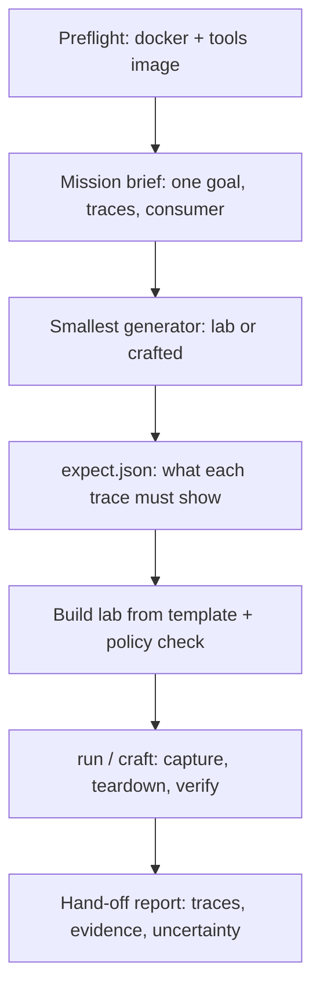

# cyberlab

> Describe what the lab is for; get the smallest isolated Docker lab for that one mission, and trace files proven to show what you asked.

[](LICENSE)

An agent skill that sets up the **smallest isolated lab for one mission** and hands back trace files proven to show what was asked: an attack/benign pcap pair for a detection rule, or a capture of a protocol for a parser.

You (or a calling agent) say what the lab is for. The skill writes a one-goal mission brief, picks the smallest generator (a real-server Docker lab, or a crafted synthetic trace), writes what each trace must show as tshark expectations, runs the lab, tears it down and verifies the traces. No IDS, DPI or SIEM goes into the lab: the consumer replays the traces with its own tools.

## Features

- **One mission, one task:** one lab directory per task (one protocol or attack, for one consumer), holding as many traces as the task needs. Come back later for another variant, threshold or error case and the skill adds traces to the same lab (`cyberlab labs` lists them); an unrelated task gets its own lab.
- **Minimal labs:** one victim, one generator and one capture sidecar on an internal Docker network.
- **Expectations first:** `expect.json` holds tshark filters with bounds per trace: frame or message counts, the most matches in a time window (`window`), distinct field values (`distinct`) and spacing (`gap_min`/`gap_max`), so every claim in the brief, rule thresholds included, is checked. `run` and `craft` refuse a trace that has no expectation, and a trace is done only when its expectations pass.
- **Isolation checked three times:** an allowlist policy on the compose file before start, the running containers and networks, and the teardown (see [Safety](#safety)).
- **Crafted traces when no implementation exists:** payloads behind real Ethernet/IP/TCP/UDP headers, written with no network and labelled synthetic.
- **Attack mechanism:** each lab has a `mechanism.md` with how the attack (or protocol) works, what each trace shows of it, and links to the CVE, RFC, MITRE ATT&CK or vendor write-up. Every template ships one.
- **Provenance and reproduction:** each trace gets an `out/<trace>.provenance.json` (origin, frames, sha256, the exact command, images with registry digests, the sha256 of every lab file) and an `out/<trace>.md` that explains what the trace contains, how the attack works, how it was generated and how someone else reproduces it.
- **Host needs only Docker:** every check runs in a small tools image (tcpdump, tshark, Python).

## How it works



The agent follows these steps in [`skills/cyberlab/SKILL.md`](skills/cyberlab/SKILL.md) and ends with a short hand-off report (Result, Traces, Evidence, Uncertainty, Decision).

## Installation

The host needs only Docker with Compose v2. Validated on macOS (arm64, Docker Desktop) and Ubuntu 24.04 (arm64, Docker Engine); Windows has not been run.

Install the skill with one of these:

```bash
# npx (Vercel skills CLI)
npx skills add https://github.com/montimage-projects/cyberlab --skill cyberlab

# asm (agent-skill-manager: npm install -g agent-skill-manager)
asm install github:montimage-projects/cyberlab --path skills/cyberlab -p claude -s global

# or by hand: copy skills/cyberlab/ into your agent's skills directory
git clone https://github.com/montimage-projects/cyberlab.git
cp -R cyberlab/skills/cyberlab ~/.claude/skills/
```

Both installers ask which agent and scope to use when you leave those out. The commands below assume a global Claude Code install (`~/.claude/skills/cyberlab/`); adjust the path for another agent or a project install.

Then check the host and build the tools image:

```bash
~/.claude/skills/cyberlab/scripts/cyberlab doctor   # docker, compose, tools image
~/.claude/skills/cyberlab/scripts/cyberlab build    # builds cyberlab/tools:local (tcpdump, tshark, python3)
```

## Quick start

Ask your agent:

```text
/cyberlab traces for an FTP brute-force rule: 5+ failed logins, and a normal login as benign
```

Or drive the CLI by hand with a template, which ships its own `expect.json`:

```bash
S=~/.claude/skills/cyberlab/scripts
$S/cyberlab templates                                         # list the lab templates
$S/cyberlab new ~/labs/ftp --from ftp-bruteforce              # copy a template into a lab directory
$S/cyberlab check ~/labs/ftp                                  # isolation policy on the resolved compose file
$S/cyberlab run ~/labs/ftp attack                             # -> ~/labs/ftp/out/attack.pcap
$S/cyberlab run ~/labs/ftp benign                             # -> ~/labs/ftp/out/benign.pcap
$S/cyberlab status ~/labs/ftp                                 # should print: no cyberlab lab resources
```

The first run builds the template's images. Each `run` prints one `PASS`/`FAIL` line per check and per expectation, then `RESULT PASS` when the trace shows what `expect.json` asks for.

## Usage

From an agent, describe the mission in one sentence (as in [Quick start](#quick-start)), or from another skill: "use cyberlab to produce capture.pcap of <protocol> under tcp:port=<n> in <dir>". To continue a mission later, name its lab or the task ("add a slow brute-force trace to the FTP lab"): the skill adds traces under new names and leaves the earlier ones alone.

The CLI underneath (`skills/cyberlab/scripts/cyberlab --help`):

| Command | Does |
|---|---|
| `cyberlab doctor` / `build` | check docker, compose and the tools image / build the tools image |
| `cyberlab templates` / `new <dir> --from <t>` | list / copy a lab template |
| `cyberlab labs [dir]` | list mission labs (goal, scope, traces) to find one to continue |
| `cyberlab check <lab>` | isolation policy on the resolved compose file |
| `cyberlab run <lab> <mode>` | policy, up, runtime isolation check, generate, capture (fails on dropped packets), verified teardown, verify `out/<mode>.pcap` |
| `cyberlab craft <lab> <trace> -- <args>` | synthetic trace with no network, then verify |
| `cyberlab craft <lab> <trace> --script <file.py> [-- args]` | same, from your own generator script in the lab directory |
| `cyberlab verify <lab> [trace.pcap]...` | check traces against `expect.json` (and rewrite their documents) |
| `cyberlab doc <lab> [trace.pcap]...` | (re)write `out/<trace>.md`, the reproduction document, e.g. for traces made before documents existed |
| `cyberlab status [lab]` / `down <lab>` / `nuke` | list / stop one / remove every cyberlab lab (`status` is the dry run of `nuke`) |

Exit codes: `0` ok, `1` usage or environment error, `2` a policy, lab or expectation check failed.

A crafted trace, for a protocol with no runnable implementation (from [`references/crafted.md`](skills/cyberlab/references/crafted.md)):

```bash
cyberlab craft <lab> capture.pcap -- --parent udp:dport=5684 --payload "40 01 00 01" --payload "s:60 45 00 01"
```

### Output

A lab directory holds `mission.md` (with a `## Log` of each request), `mechanism.md`, `expect.json`, the lab files and `out/`: the traces, one `<trace>.provenance.json` and one `<trace>.md` each, the generator log and `verify.json`.

`<trace>.md` is the trace's document, written from the brief, `mechanism.md`, the expectations, the verification result, the provenance and tshark summaries of the trace:

- **What it contains:** the brief's description, the protocol hierarchy, the conversations and the first 40 packets.
- **Mechanism:** how the attack or protocol works, what this trace shows of it, and the references, from `mechanism.md`.
- **What was checked:** the trace's expectations and the last verification result.
- **How it was generated:** the command, `MODE`/`PCAP`, the resolved lab services, image IDs, registry digests and Dockerfile base images, tool and Docker versions, and the sha256 of every lab file (with a flag on any file changed since).
- **How to reproduce:** the steps, and what "the same" means. A trace crafted with `craft_pcap.py` reproduces byte for byte (same sha256). A lab capture reproduces as an equivalent trace that passes the same expectations but is never the same file: timestamps, TCP sequence numbers, client ports and container addresses change on every run.

To reproduce a trace, share the lab directory with it: the document lists the files that directory must hold.

## Configuration

| Variable | Default | Used by |
|---|---|---|
| `CYBERLAB_TOOLS` | `cyberlab/tools:local` | the CLI: tools image for checks, capture and crafting |
| `CYBERLAB_TIMEOUT` | `300` | the CLI: seconds `run` waits for the generator before tearing the lab down |
| `CYBERLAB_HOME` | `$HOME/.cache/cyberlab` | the agent (SKILL.md Step 1): parent of new lab directories when the caller names none; `cyberlab labs`: directory it lists when given none |

## Templates (all run end to end)

| Template | Modes | Result on the reference run |
|---|---|---|
| `ftp-bruteforce` | attack, benign | 8 × `530` replies vs one `230` login (ProFTPD, real server delay) |
| `h2c-rapid-reset` | attack, benign | 100 RST_STREAM frames in ~47 packets vs 100 paced streams (nginx h2c) |
| `http-payloads` | attack, benign | Log4Shell, SQLi, traversal, XXE, Shellshock strings vs normal requests (nginx) |
| `port-scan` | attack, benign | 1,024 SYNs / 1,023 RSTs vs 5 HTTP requests |
| `protocol-capture` | capture | Redis RESP requests and replies, both directions, with an error reply |

## Safety

Every lab is checked before start (an allowlist: internal networks whose bridge gives the host no address, no published ports, no privileged or host namespaces, capabilities limited to NET_RAW/NET_ADMIN, no engine socket, bind mounts inside the lab, no restart policies, a capture that only tcpdump can write), while running (networks internal, no ports, not privileged) and after teardown (nothing left).

Escape tests from inside a lab (public IPs, DNS, `host.docker.internal`, every TCP port the host listens on) were all blocked on macOS (Docker Desktop, arm64) and on Ubuntu 24.04 (Docker Engine, arm64). On Linux, `internal: true` alone still let a lab reach the host's own services through the bridge gateway; the required `com.docker.network.bridge.inhibit_ipv4` option closes that. Isolation is Docker-level, not a VM: see [`skills/cyberlab/references/safety.md`](skills/cyberlab/references/safety.md).

## Project structure

```text
.
├── skills/cyberlab/            the skill
│   ├── SKILL.md                agent instructions (Steps 0-6, hand-off report)
│   ├── scripts/
│   │   ├── cyberlab            CLI
│   │   ├── lab_policy.py       isolation policy for a resolved compose file
│   │   ├── verify.py           expectations check (tshark filters, frame counts, endpoints)
│   │   ├── craft_pcap.py       synthetic traces: payloads behind real headers
│   │   └── trace_doc.py        per-trace provenance and reproduction document
│   ├── references/             mission brief, lab authoring, crafted traces, safety
│   ├── assets/labs/            templates: ftp-bruteforce, h2c-rapid-reset, http-payloads, port-scan, protocol-capture
│   ├── assets/tools/           the tools image (tcpdump, tshark, Python)
│   ├── evals/evals.json        agent-behaviour evals
│   └── docs/README.md          catalog page for the skill
└── examples/mmt-workbench/     example consumer, not part of the skill
```

`examples/mmt-workbench/` is an example *consumer* environment: a Linux image with mmt-dpi, mmt-security and mmt-plugin that replays cyberlab traces (`detect.sh`). See [its README](examples/mmt-workbench/README.md).

## Documentation

- [`skills/cyberlab/SKILL.md`](skills/cyberlab/SKILL.md): the workflow the agent follows
- [`skills/cyberlab/references/mission.md`](skills/cyberlab/references/mission.md): mission brief, choosing the generator, `expect.json` format
- [`skills/cyberlab/references/lab-authoring.md`](skills/cyberlab/references/lab-authoring.md): adapting a template, failures seen before
- [`skills/cyberlab/references/crafted.md`](skills/cyberlab/references/crafted.md): crafted (synthetic) traces
- [`skills/cyberlab/references/safety.md`](skills/cyberlab/references/safety.md): threat model and payload rules
- [`skills/cyberlab/docs/README.md`](skills/cyberlab/docs/README.md): skill overview
- [`examples/mmt-workbench/README.md`](examples/mmt-workbench/README.md): replaying traces with MMT

## Contributing

Bug reports, new templates and platform reports (Windows has not been run) are welcome. Open an issue or a pull request on [montimage-projects/cyberlab](https://github.com/montimage-projects/cyberlab). Before proposing a template, run `cyberlab check` on it and `cyberlab run` for each mode in its `expect.json`, and include the output.

## License

Apache License 2.0: see [LICENSE](LICENSE). `skills/cyberlab/` carries its own copy ([`skills/cyberlab/LICENSE`](skills/cyberlab/LICENSE)), so the skill stays licensed when copied on its own.

## Acknowledgments

The example consumer builds on Montimage's MMT tools: [mmt-dpi](https://github.com/Montimage/mmt-dpi), [mmt-security](https://github.com/Montimage/mmt-security) and [mmt-plugin-generator](https://github.com/Montimage/mmt-plugin-generator). The labs use tcpdump, tshark (Wireshark), ProFTPD, nginx and Redis.
