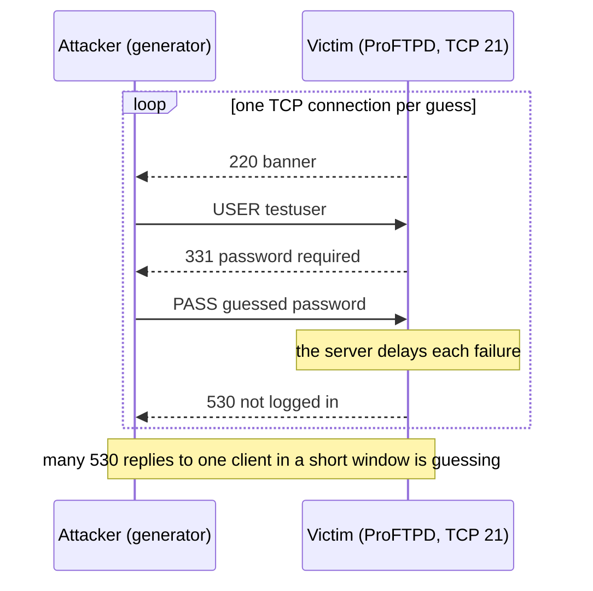
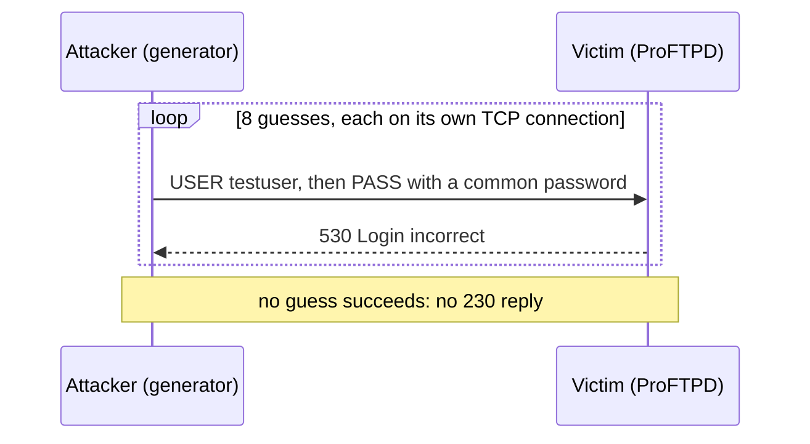
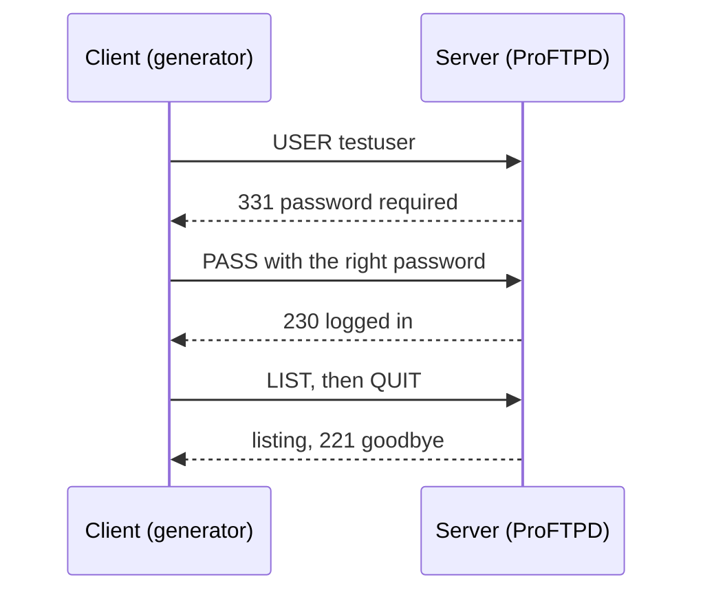

# Mechanism: FTP brute force (password guessing)

**Who is who:** the attacker is the lab's `generator` service (Python `ftplib`, one control connection per guess); the victim is the `victim` service (ProFTPD on TCP 21, one account). Docker gives them new addresses on every run: each trace's document (`out/<trace>.md`) opens with them.

An attacker who knows or guesses a user name tries one password after another against the FTP login until one works. FTP (RFC 959) authenticates in cleartext on the control channel (TCP 21): the client sends `USER <name>`, the server answers `331` (password required), the client sends `PASS <password>`, and the server answers `230` (logged in) or `530` (not logged in). Each wrong guess therefore leaves a `PASS` request followed by a `530` reply on the wire.

What a detector keys on is the rate: many `530` replies to the same client, for the same user, within a short window. One failed login is a typing mistake; five or more in a few seconds is guessing. ProFTPD delays each `530`, which makes the timing in the trace realistic for a time-window rule.

## attack.pcap

Eight logins as `testuser` with common passwords (`123456`, `password`, `admin`, `qwerty`, `letmein`, `root`, `test`, `ftp`), each on its own TCP connection, each answered by `530`.

## benign.pcap

One login with the right password, a file listing and `QUIT`. No `530` reply.

## References

- [RFC 959: File Transfer Protocol](https://www.rfc-editor.org/rfc/rfc959) — the `USER`/`PASS` commands and the `230`, `331` and `530` replies.
- [MITRE ATT&CK T1110.001: Brute Force: Password Guessing](https://attack.mitre.org/techniques/T1110/001/) — the technique and how it is detected.
- [CWE-307: Improper Restriction of Excessive Authentication Attempts](https://cwe.mitre.org/data/definitions/307.html) — the weakness the attack exploits.
