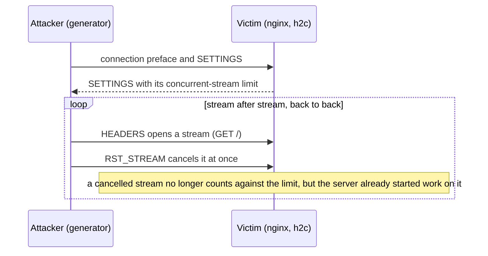
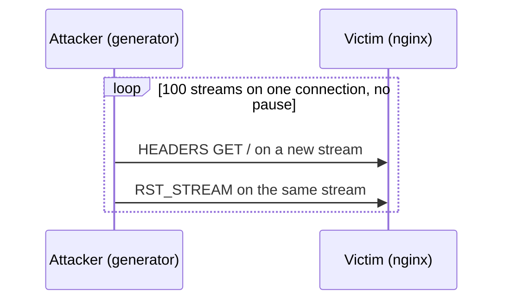
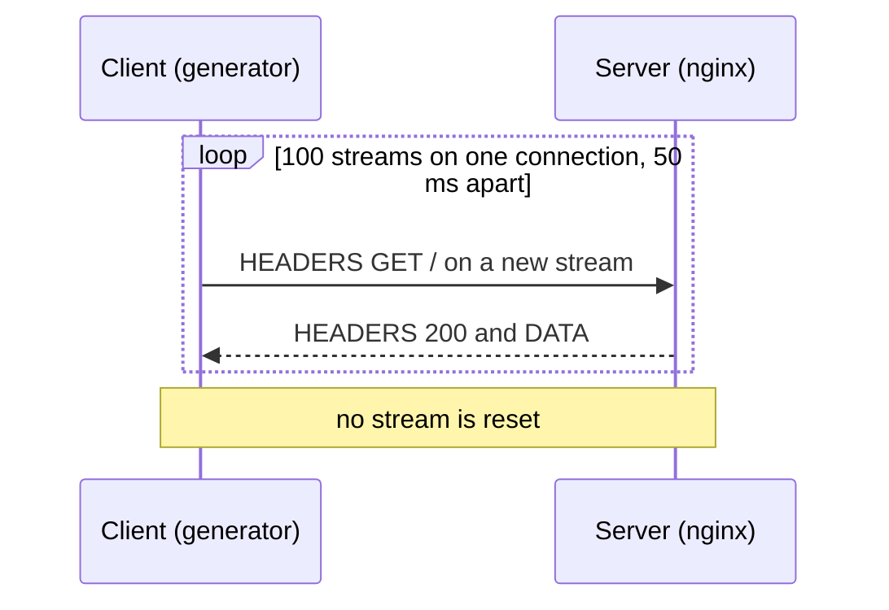

# Mechanism: HTTP/2 Rapid Reset (CVE-2023-44487)

**Who is who:** the attacker is the lab's `generator` service (a client built on the Python `h2` library); the victim is the `victim` service (nginx serving cleartext HTTP/2, h2c, on TCP 80). Docker gives them new addresses on every run: each trace's document (`out/<trace>.md`) opens with them.

HTTP/2 (RFC 9113) carries many requests as streams on one TCP connection. A client opens a stream with a `HEADERS` frame and may cancel it at any time with `RST_STREAM` (frame type 3). The server's limit on concurrent streams (`SETTINGS_MAX_CONCURRENT_STREAMS`) counts only open streams, and a cancelled stream is closed at once. So a client can open a stream and reset it straight away, over and over, without ever reaching the limit, while each stream still makes the server parse headers and start work. A few connections can then push a server to a very high request rate. This was exploited in 2023 in DDoS attacks of hundreds of millions of requests per second.

What a detector keys on: a high count of `RST_STREAM` frames sent by the client, each right after the `HEADERS` frame of the same stream, in a short time on one connection. A normal client rarely cancels streams, and does not cancel all of them.

The lab uses cleartext HTTP/2 (h2c) so the frames are visible in the trace (over TLS they would be encrypted). One TCP segment often carries several frames, so the expectations count frames with `count_field`, not packets.

## attack.pcap

On one connection, 100 streams, each a `GET /` `HEADERS` frame followed at once by an `RST_STREAM` for the same stream, sent back to back.

## benign.pcap

On one connection, 100 `GET /` streams paced 50 ms apart and never reset: the server answers each one.

## References

- [CVE-2023-44487 (NVD)](https://nvd.nist.gov/vuln/detail/CVE-2023-44487) — the vulnerability record.
- [HTTP/2 Rapid Reset: deconstructing the record-breaking attack (Cloudflare)](https://blog.cloudflare.com/technical-breakdown-http2-rapid-reset-ddos-attack/) — how the attack works and what was seen in the wild.
- [RFC 9113: HTTP/2](https://www.rfc-editor.org/rfc/rfc9113) — streams, `HEADERS`, `RST_STREAM` and `SETTINGS_MAX_CONCURRENT_STREAMS`.
