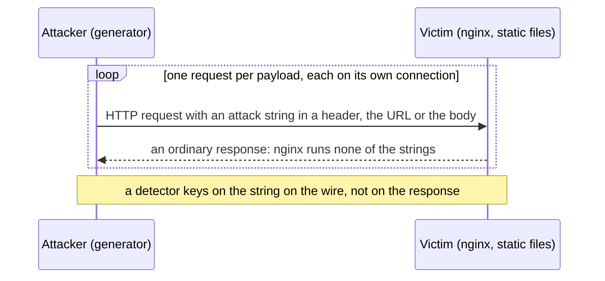
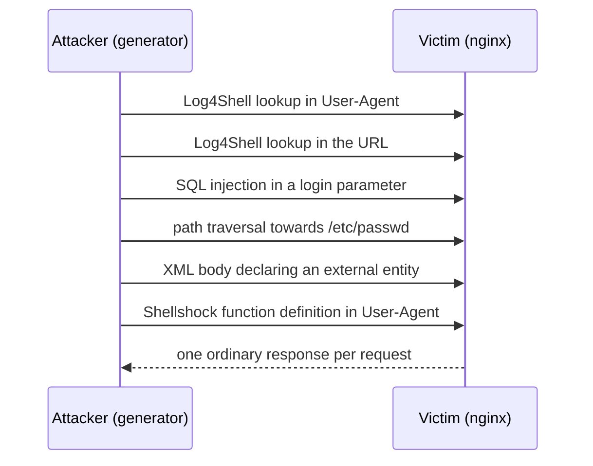
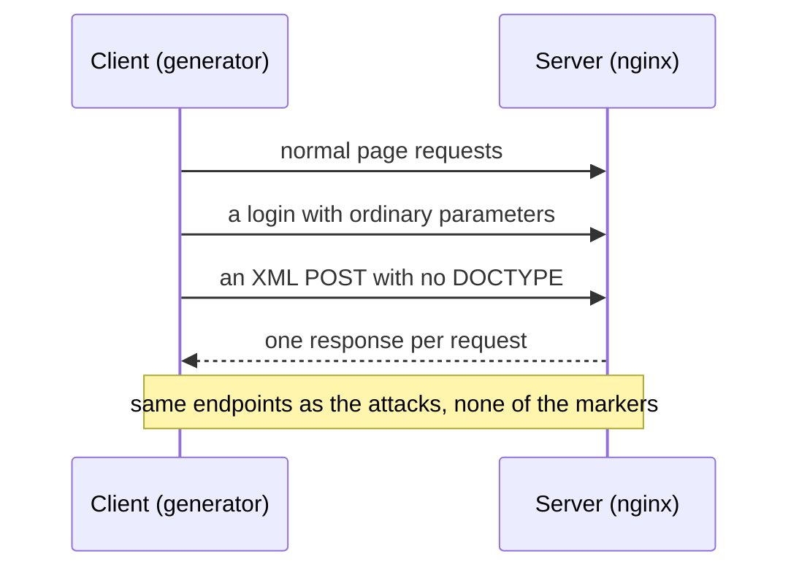

# Mechanism: web attack payloads in HTTP requests

**Who is who:** the attacker is the lab's `generator` service (a standard-library Python HTTP client); the victim is the `victim` service (nginx serving static files on TCP 80, which executes none of the strings). Docker gives them new addresses on every run: each trace's document (`out/<trace>.md`) opens with them.

Many web attacks are carried in a single HTTP request. The attacker puts a string in a header, the URL or the body that a vulnerable application will interpret instead of treating as data. A detector cannot see whether the server was vulnerable, but it can see the string on the wire. This lab sends the classic strings to a server that executes none of them, so the trace shows the attempts without any exploitation.

- **Log4Shell (CVE-2021-44228):** Log4j 2 expanded `${jndi:ldap://…}` lookups in logged strings and loaded code from the named server. Attackers put the lookup in any field likely to be logged: `User-Agent`, URL parameters. Detector marker: `${jndi:` in plain or URL-encoded form.
- **SQL injection:** a parameter closes the SQL string and adds its own logic (`admin' OR '1'='1`), so the query matches every row. Marker: quote characters followed by SQL keywords in a parameter.
- **Path traversal:** `../` sequences climb out of the web root to read files such as `/etc/passwd`. Marker: `../` in the path.
- **XML external entity (XXE):** an XML body declares an external entity (`<!ENTITY x SYSTEM "file:///etc/passwd">`) that a permissive parser resolves. Marker: `<!DOCTYPE` with `<!ENTITY … SYSTEM` in a request body.
- **Shellshock (CVE-2014-6271):** Bash ran the commands that follow a function definition held in an environment variable, and CGI copies headers into environment variables. Marker: `() {` at the start of a header value.

Every callback host uses the reserved `.invalid` domain, and the lab network has no route out, so no payload can reach anything.

## attack.pcap

One request per line of `payloads/attack.jsonl`, each on its own connection.

## benign.pcap

Normal requests from `payloads/benign.jsonl` to the same server, holding none of the markers above. They hit the same endpoints as the attacks, so a rule has to key on the markers, not on the endpoints.

## References

- [CVE-2021-44228 (NVD)](https://nvd.nist.gov/vuln/detail/CVE-2021-44228) — Log4Shell.
- [CVE-2014-6271 (NVD)](https://nvd.nist.gov/vuln/detail/CVE-2014-6271) — Shellshock.
- [OWASP: SQL Injection](https://owasp.org/www-community/attacks/SQL_Injection)
- [OWASP: Path Traversal](https://owasp.org/www-community/attacks/Path_Traversal)
- [OWASP: XML External Entity (XXE) Processing](https://owasp.org/www-community/vulnerabilities/XML_External_Entity_(XXE)_Processing)
- [MITRE ATT&CK T1190: Exploit Public-Facing Application](https://attack.mitre.org/techniques/T1190/) — the technique these attempts belong to.
