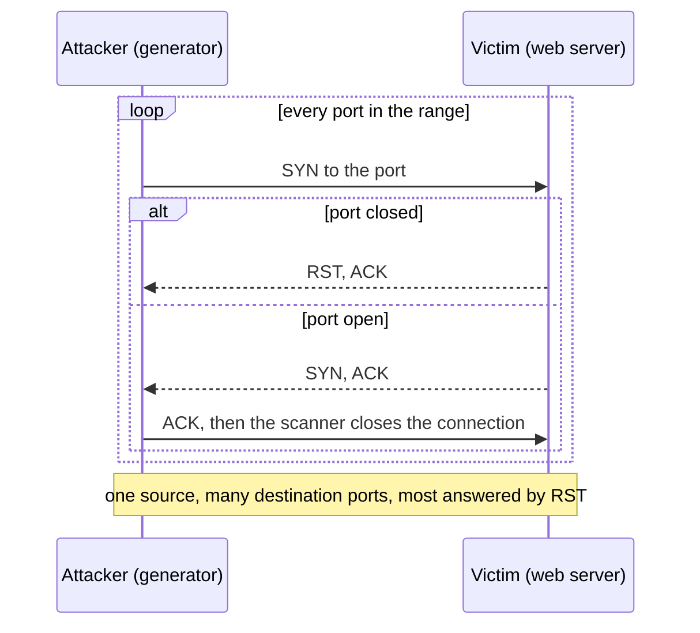
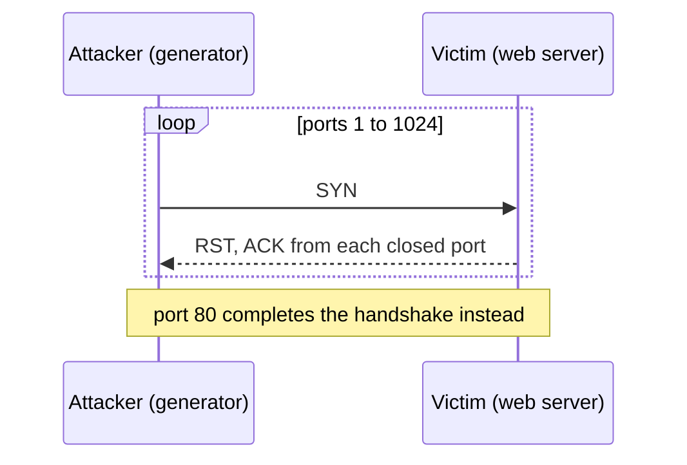
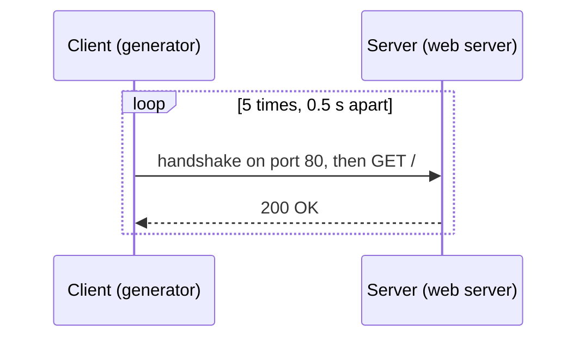

# Mechanism: TCP connect port scan

**Who is who:** the attacker is the lab's `generator` service (a standard-library Python scanner); the victim is the `victim` service (one web server, so port 80 is open and the rest are closed). Docker gives them new addresses on every run: each trace's document (`out/<trace>.md`) opens with them.

Before attacking a host, an attacker finds which services it runs by trying to connect to many ports. In a TCP connect scan, the scanner calls the operating system's normal `connect()` on each port: an open port completes the three-way handshake and the scanner closes it at once, a closed port answers the `SYN` with `RST/ACK` (RFC 9293). The scanner needs no special privileges, which is why this is nmap's default scan when raw sockets are not available (`-sT`).

What a detector keys on: one source sending `SYN`s to many different destination ports of one host in a short time, most of them answered by `RST`. Normal clients talk to a few known ports.

The generator is a standard-library Python loop with a 0.5 s timeout per port.

## attack.pcap

A connect scan of ports 1–1024 of the victim: 1,024 `SYN`s, `RST` replies from every closed port, and one completed handshake on the open port.

## benign.pcap

Five `GET /` requests to the web server on port 80, 0.5 s apart: one destination port, every handshake completed.

## References

- [Nmap: TCP Connect Scan (-sT)](https://nmap.org/book/scan-methods-connect-scan.html) — how a connect scan works and what it leaves on the wire.
- [MITRE ATT&CK T1046: Network Service Discovery](https://attack.mitre.org/techniques/T1046/) — the technique and how it is detected.
- [RFC 9293: Transmission Control Protocol](https://www.rfc-editor.org/rfc/rfc9293) — the handshake, and the `RST` a closed port sends.
