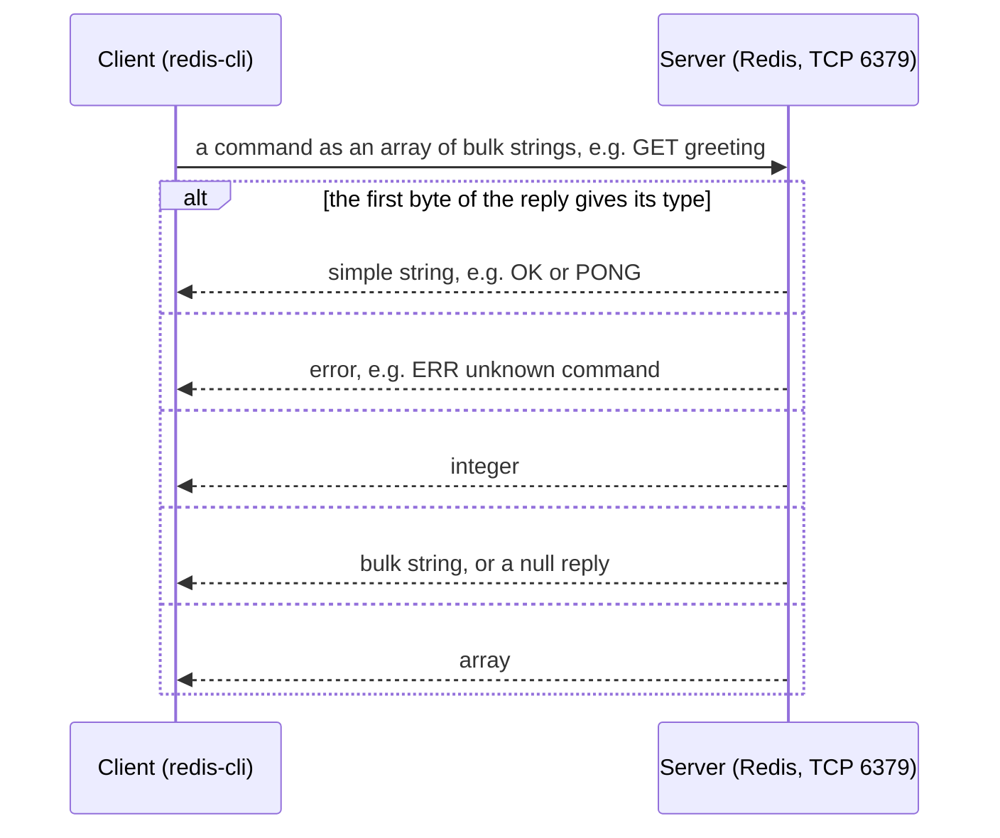
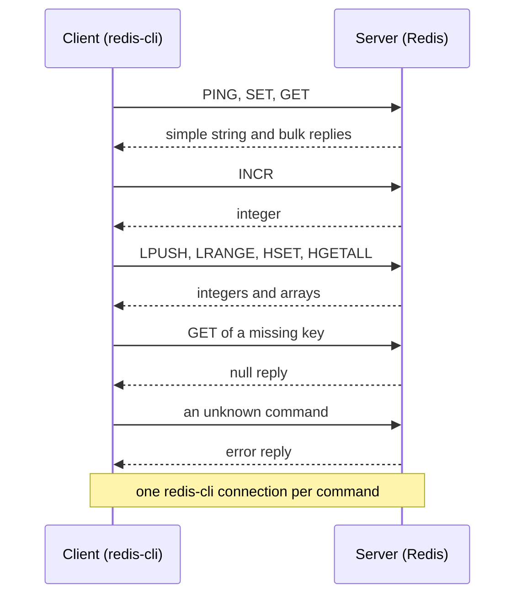

# Mechanism: Redis RESP request/reply exchange

This is not an attack. The mission is to capture a protocol for a parser, so this file explains how the protocol works. Replace it with the target protocol's description when you adapt the template.

**Who is who:** the client is the lab's `generator` service (the official `redis-cli`); the server is the `victim` service (Redis on TCP 6379). Docker gives them new addresses on every run: each trace's document (`out/<trace>.md`) opens with them.

Redis clients and servers speak RESP (REdis Serialization Protocol) over TCP 6379. A client sends each command as an array of bulk strings: `*<count>\r\n`, then `$<length>\r\n<bytes>\r\n` for each element, e.g. `*2\r\n$3\r\nGET\r\n$8\r\ngreeting\r\n`. The first byte of a reply gives its type:

- `+` simple string (`+OK`, `+PONG`)
- `-` error (`-ERR unknown command …`)
- `:` integer (`:1`)
- `$` bulk string, or `$-1` for a missing value (a null reply in RESP2)
- `*` array

A parser has to handle each reply type, lengths that do not match the line breaks, and both directions of the flow.

## capture.pcap

One `redis-cli` connection per command, from the official Redis client to the Redis server, covering every reply type: simple string, bulk string, integer, array, null and error.

## References

- [Redis serialization protocol specification](https://redis.io/docs/latest/develop/reference/protocol-spec/) — the wire format and every reply type.
