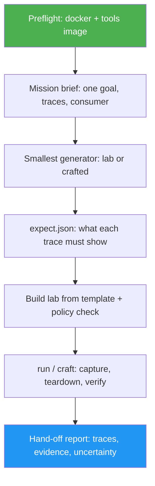

<!--
  DO NOT READ THIS FILE — This README.md is for human catalog browsing only.
  It ships inside the .skill package but is NEVER auto-loaded into agent context.
  The runtime loader only reads SKILL.md + references/ + scripts/ + agents/ when the skill triggers.
  If you're an AI agent, read the SKILL.md file instead for skill instructions.
-->

# cyberlab

> Describe what the lab is for; get the smallest isolated Docker lab for that one mission, and trace files proven to show what you asked.

## Highlights

- One mission, one goal: an attack/benign pcap pair for a detection rule, or a capture of a protocol for a parser.
- Minimal labs: one victim, one generator, one capture sidecar; no IDS or DPI inside — consumers replay the traces with their own tools.
- Safety checked three times: a positive policy on the compose file, the running containers and network, and the teardown.
- Expectations first: tshark filters with frame-count bounds in `expect.json`; a trace is done only when they pass.
- Host needs only Docker (validated on macOS arm64 Docker Desktop; Linux and Windows expected, not yet run); crafted synthetic traces need no network at all.

## When to Use

| Say this... | Skill will... |
|---|---|
| "Give me attack and benign pcaps for an FTP brute-force rule" | Build the ftp-bruteforce lab, run both modes, verify, hand off |
| "Capture Redis traffic in both directions for my parser" | Build a protocol-capture lab with the real server and client |
| "No implementation exists, here are the message bytes" | Craft a synthetic trace with `cyberlab craft`, labelled synthetic |
| "Called by mmt-security-rule-generator / mmt-plugin-generator" | Derive the mission from the caller's request without questions |

## How It Works



## Usage

```
/cyberlab traces for an FTP brute-force rule
```

## Resources

| Path | Description |
|---|---|
| `scripts/cyberlab` | CLI: doctor, build, templates, new, check, run, craft, verify, down, status, nuke |
| `scripts/lab_policy.py` | isolation policy for a resolved compose file |
| `scripts/verify.py` | expectations check (tshark filters, frame counts, endpoints) |
| `scripts/craft_pcap.py` | synthetic traces: payloads behind real Ethernet/IP/TCP/UDP headers |
| `assets/tools/` | the tools image (tcpdump, tshark, Python) |
| `assets/labs/` | templates: ftp-bruteforce, h2c-rapid-reset, http-payloads, port-scan, protocol-capture |
| `references/` | mission brief and expectations, lab authoring, crafted traces, safety |

## Output

A lab directory with `mission.md`, `expect.json`, the lab files and `out/`: the traces, one `<trace>.provenance.json` each (origin, images, frames, sha256), the generator log and `verify.json`; plus a short hand-off report (Result, Traces, Evidence, Uncertainty, Decision).
