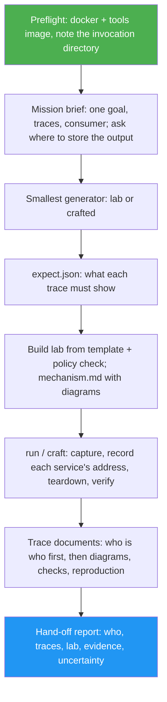
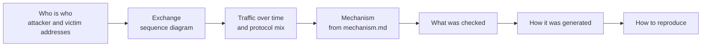

<!--
  DO NOT READ THIS FILE — This README.md is for human catalog browsing only.
  It ships inside the .skill package but is NEVER auto-loaded into agent context.
  The runtime loader only reads SKILL.md + references/ + scripts/ + agents/ when the skill triggers.
  If you're an AI agent, read the SKILL.md file instead for skill instructions.
-->

# cyberlab

> Describe what the lab is for; get the smallest isolated Docker lab for that one mission, and trace files proven to show what you asked.

## Highlights

- One mission, one task: attack and benign pcaps for a detection rule, or captures of a protocol for a parser, with as many traces as the task needs. Later work on the same task reuses the lab (`cyberlab labs` finds it); an unrelated task gets a new one.
- Minimal labs: one victim, one generator, one capture sidecar; no IDS or DPI inside — consumers replay the traces with their own tools.
- Safety checked three times: an allowlist policy on the compose file (internal network, no host address on the bridge), the running containers and network, and the teardown.
- Expectations first: tshark filters with frame-count bounds in `expect.json`; a trace is done only when they pass.
- Output where you work: the agent asks where to store the lab and its traces, and defaults to the directory you invoked it from.
- Diagrams before text: every trace document opens with who is who (the attacker and the victim, with their IP addresses as captured) and draws the exchange, the traffic over time and the protocol mix as Mermaid diagrams; `mechanism.md` explains the attack with sequence diagrams.
- Host needs only Docker (validated on macOS arm64 Docker Desktop and Ubuntu 24.04 arm64; Windows not yet run); crafted synthetic traces need no network at all.

## When to Use

| Say this... | Skill will... |
|---|---|
| "Give me attack and benign pcaps for an FTP brute-force rule" | Build the ftp-bruteforce lab, run both modes, verify, hand off |
| "Capture Redis traffic in both directions for my parser" | Build a protocol-capture lab with the real server and client |
| "No implementation exists, here are the message bytes" | Craft a synthetic trace with `cyberlab craft`, labelled synthetic |
| "Called by mmt-security-rule-generator / mmt-plugin-generator" | Derive the mission from the caller's request without questions |

## How It Works



What one trace document shows, top to bottom:



## Usage

```
/cyberlab traces for an FTP brute-force rule
```

## Resources

| Path | Description |
|---|---|
| `scripts/cyberlab` | CLI: doctor, build, templates, labs, new, check, run, craft, verify, doc, down, status, nuke |
| `scripts/lab_policy.py` | isolation policy for a resolved compose file |
| `scripts/verify.py` | expectations check (tshark filters, frame counts, endpoints) |
| `scripts/craft_pcap.py` | synthetic traces: payloads behind real Ethernet/IP/TCP/UDP headers |
| `scripts/trace_doc.py` | per-trace provenance and document (`out/<trace>.md`): who is who, Mermaid diagrams, checks, reproduction |
| `assets/tools/` | the tools image (tcpdump, tshark, Python) |
| `assets/labs/` | templates: ftp-bruteforce, h2c-rapid-reset, http-payloads, port-scan, protocol-capture |
| `references/` | mission brief and expectations, lab authoring, crafted traces, safety |

## Output

A lab directory, in the directory you invoked the skill from unless you name another, with `mission.md`, `mechanism.md` (who is who and Mermaid diagrams of the attack), `expect.json`, the lab files and `out/`: the traces, one `<trace>.md` document and one `<trace>.provenance.json` each (origin, images, service addresses, frames, sha256), the generator log and `verify.json`; plus a short hand-off report (Result, Who, Traces, Lab, Evidence, Uncertainty, Decision).
